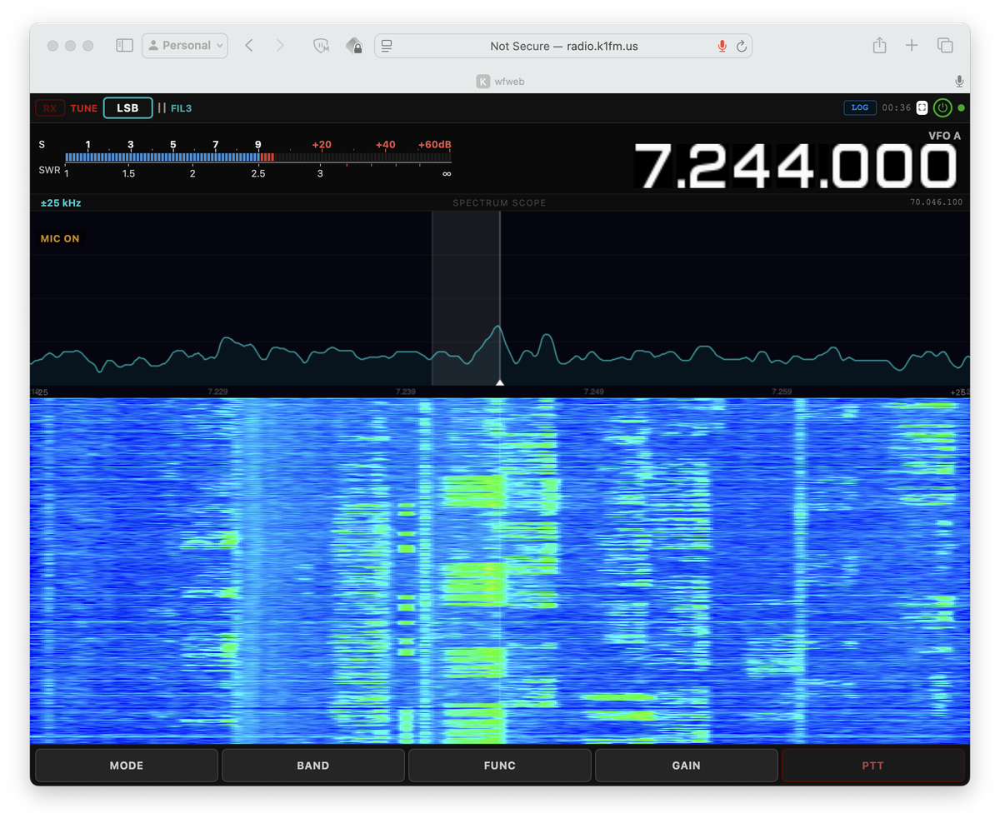
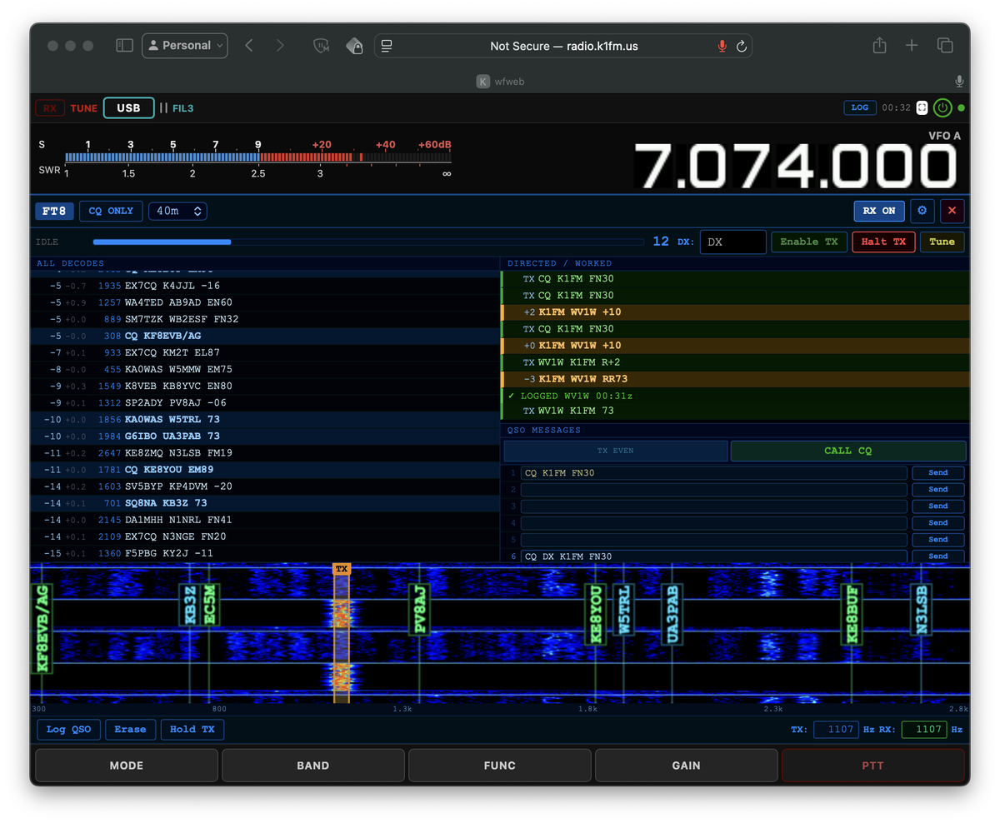
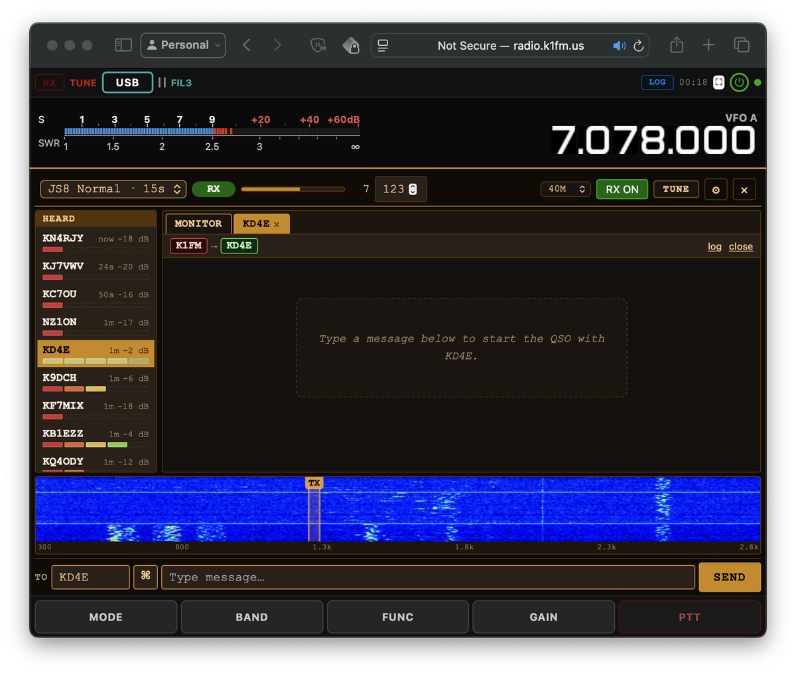
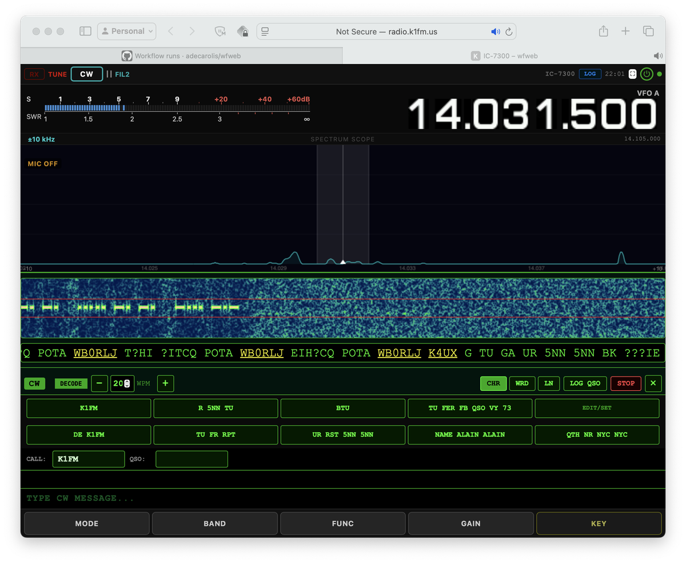
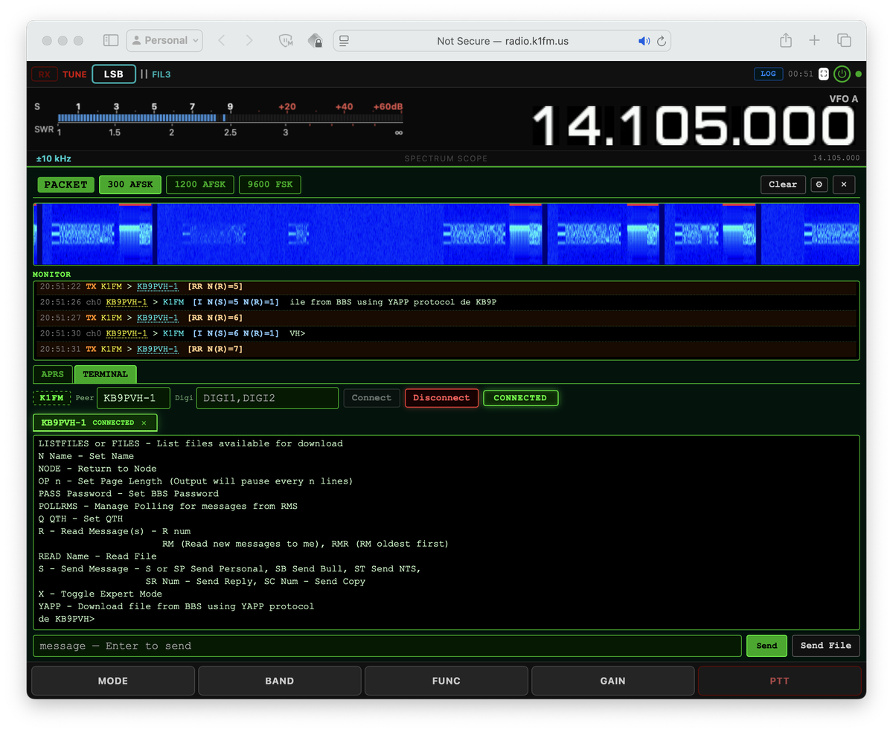
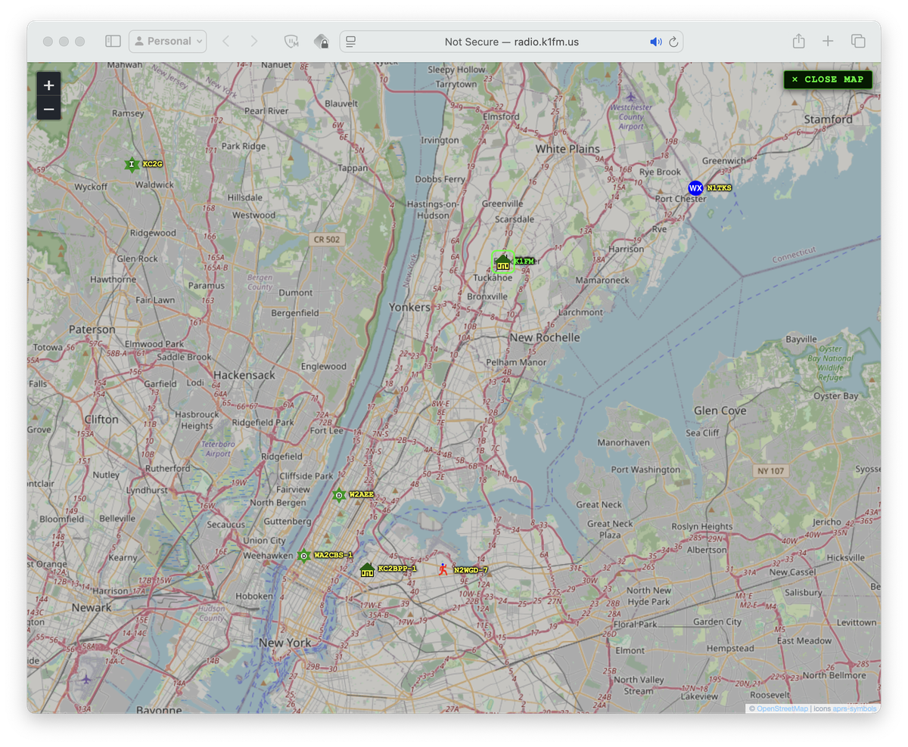

# wfweb

**Control your Icom radio from any browser — phone, tablet, or desktop.**

wfweb turns your transceiver into a web-accessible station. Waterfall, SSB, CW decoding, FT8/FT4, JS8 messaging, FreeDV digital voice, [RADE](https://youtu.be/Rj9E1CAQ9Ls), and AX.25 packet (APRS, connected QSOs, file transfer) — all in the browser, no client software required.



**SSB** — spectrum scope and waterfall, with the browser's own microphone keying the rig.



**FT8 / FT4** — decode, call and log without leaving the page; every decode is marked on the waterfall and tagged with its DXCC entity, with stars for new ones.



**JS8** — keyboard-to-keyboard messaging, with stations heard and their signal reports, a tab per QSO, and submodes from Slow down to JS8 60.



**CW** — built-in decoder and keyer, editable macros, break-in, a paddle through a MIDI controller or USB keyboard adapter, and one-click QSO logging.



**Packet** — AX.25 connected mode at 300, 1200 and 9600 baud: BBS sessions, frame monitor, and YAPP file transfer.



**APRS** — received beacons plotted live on the map, drawn with the real APRS symbol set.

---

## What wfweb adds over wfview

wfweb is a fork of [wfview](https://gitlab.com/eliggett/wfview), the outstanding open-source front-end for Icom, Kenwood, and Yaesu transceivers by Elliott H. Liggett W6EL, Phil E. Taylor M0VSE, and contributors.

wfweb keeps wfview's radio engine and replaces the desktop GUI with a built-in web interface:

| Feature | wfview | wfweb |
|---|:---:|:---:|
| Desktop GUI (Qt) | ✓ | — |
| Full radio control (CI-V, LAN) | ✓ | ✓ |
| Waterfall display | ✓ | ✓ |
| Audio over LAN | ✓ | ✓ |
| Built-in HTTP/WebSocket server | — | ✓ |
| Browser-based remote control | — | ✓ |
| Browser RX audio streaming | — | ✓ |
| Browser TX audio (mic to rig) | — | ✓ |
| CW decoder (DeepCW neural model in-browser; ggmorse fallback) | — | ✓ |
| CW paddle input (MIDI controller or USB keyboard adapter) | — | ✓ |
| MIDI controller (CTR2-MIDI presets, MIDI learn) | — | ✓ |
| FT8/FT4 DIGI panel (full QSO) | — | ✓ |
| JS8 messenger (chat-style, QSO tabs) | — | ✓ |
| RADE (Radio Autoencoder) | — | ✓ |
| FreeDV digital voice (700D/700E/1600) | — | ✓ |
| AX.25 packet — 300/1200/9600, APRS, terminal, YAPP | — | ✓ |
| Server-side ADIF logbook, remote logging (GridTracker, JTAlert, Log4OM…) | — | ✓ |
| Recording — MP3 audio, or video of the waterfall with frequency and settings | — | ✓ |
| Mobile-responsive UI, touch key lock and latching PTT | — | ✓ |
| Headless / no-display operation | — | ✓ |

---

## Getting started

wfweb ships in two flavours. Both run in the browser; they differ in what drives the rig.

- **Standalone** — a pure-browser build that controls the rig directly over Web Serial. No server process at all. Easiest if you have a USB Icom and a Chromium-family browser.
- **Server** — the native binary. Connects to the rig over USB or LAN and serves the UI to any browser.

| | Standalone | Server |
|---|:---:|:---:|
| USB-attached rig | ✓ (Icom) | ✓ |
| LAN-attached rig | — | ✓ |
| Browser | Chromium-family only | any |
| Headless / multi-user / unattended | — | ✓ |
| FT8/FT4, JS8, CW, AX.25 packet | ✓ | ✓ |
| RADE voice | ✓ | ✓ |
| Classic FreeDV (700D/700E/1600) | — | ✓ |
| PSK Reporter / FreeDV Reporter spotting | — | ✓ |

### Standalone — no install, no server

1. Plug your Icom into your computer via USB.
2. Open **[https://wfweb.k1fm.us](https://wfweb.k1fm.us)** in Chrome, Edge, or another Chromium-family browser (Brave, Arc, Opera).
3. Click the connection dot in the top-right corner → **Connect rig**, and pick the rig's USB serial port from the OS picker. wfweb auto-probes baud rates and identifies the rig from its CI-V address.

Frequency, mode, filter, audio, FT8/FT4, JS8, CW, AX.25 packet, and RADE V1 voice all run in the browser. Subsequent visits auto-reconnect to the same port — no picker on return.

If you'd rather not depend on a third-party host, build the static bundle yourself and serve it from any HTTPS site — see [Self-hosting Standalone](#self-hosting-standalone) below.

**Limitations.** USB Icom rigs only, and Chromium-family browsers only (no Firefox, no Safari). See the table above for the features that need the Server build.

### Server — three ways to run it

1. [**Native build, USB radio**](#1-native-build--usb-radio) — any supported Icom connected by USB cable (most common)
2. [**Native build, LAN radio**](#2-native-build--lan-radio) — radios with built-in Ethernet (e.g. IC-7300 Mk2, IC-9700) or a LAN accessory
3. [**Docker**](#3-docker) — zero-install, multi-arch image for either USB or LAN radios

In every case, once wfweb is running you open `https://<host>:8080` in your browser and accept the self-signed certificate warning.

### 1. Native build — USB radio

Download a pre-built binary from [GitHub Releases](../../releases) for your platform (see [Downloads](#downloads) — on Linux, a `.deb` for Debian/Ubuntu or an `.AppImage` for any other distro), plug in your radio, and run:

```bash
./wfweb
```

With the AppImage, make it executable first and run the file itself:

```bash
chmod +x wfweb_*.AppImage
./wfweb_*.AppImage
```

That's it — any supported Icom (IC-7300, IC-7300 Mk2, IC-7610, IC-705, IC-9700, IC-7100, IC-7410) is auto-detected over USB at its default CI-V address.

If you've changed your radio's CI-V address to something non-standard, pass it explicitly:

```bash
./wfweb --civ 0x94   # hex (as shown on the radio), or decimal (148)
```

### 2. Native build — LAN radio

For Icoms with a built-in Ethernet port (IC-7300 Mk2, IC-9700, IC-7610, …) or a LAN accessory, specify the IP and credentials on the command line:

```bash
./wfweb --lan 192.168.1.100 --lan-user admin --lan-pass secret
```

Replace the IP and credentials with your radio's settings. If your radio uses a non-default CI-V address, add `--civ 0x<addr>`.

### 3. Docker

No build, no dependencies. The image `k1fm/wfweb` is multi-arch (`linux/amd64` and `linux/arm64`) — it runs on x86 servers, Raspberry Pi, and everything in between.

Always mount a volume at `/data`: it holds your settings, the TLS certificate and the QSO logbook. Without one, all of that disappears with the container (wfweb warns about it in its log and in the web UI's log panel).

**LAN radio (e.g. IC-7300 Mk2 via Ethernet):**

```bash
docker run --rm -it \
  -v wfweb-data:/data \
  -p 8080:8080 -p 8081:8081 \
  k1fm/wfweb --lan 192.168.1.100 --lan-user admin --lan-pass secret
```

To keep a container (re)start from grabbing the radio — handy when other
clients share the rig — add `-e WFWEB_NO_AUTOCONNECT=1` (or the
`--no-autoconnect` flag): wfweb starts with the LAN session closed and you
connect on demand with the web UI's **Reconnect** button.

**USB radio** (share the serial device and sound subsystem with the container):

```bash
docker run --rm -it \
  -v wfweb-data:/data \
  --device /dev/ttyUSB0 \
  --device /dev/snd --group-add audio \
  -p 8080:8080 -p 8081:8081 \
  k1fm/wfweb
```

> **Upgrading from v0.9.0 or earlier?** Settings used to live at `/root/.config/wfweb/wfweb.conf`. If you mounted a volume there, copy the file to `/data/wfweb/wfweb.conf` in the new volume (or re-enter your settings in the web UI once). See [DOCKER.md](DOCKER.md) for details.

See [Docker details](#docker-details) below for USB audio, custom serial ports, and building the image locally.

---

## Downloads

Pre-built binaries are published on [GitHub Releases](../../releases):

| Platform | Package | Distro |
|---|---|---|
| **Linux x86_64** | `.deb` (ubuntu2404) | Ubuntu 24.04 Noble |
| **Linux x86_64** | `.deb` (debian12) | Debian 12 Bookworm |
| **Linux x86_64** | `.deb` (debian13) | Debian 13 Trixie |
| **Linux ARM64 / Raspberry Pi** | `.deb` (ubuntu2404) | Ubuntu 24.04 Noble |
| **Linux ARM64 / Raspberry Pi** | `.deb` (debian12) | Raspberry Pi OS Bookworm / Debian 12 |
| **Linux ARM64 / Raspberry Pi** | `.deb` (debian13) | Raspberry Pi OS Trixie / Debian 13 |
| **Linux x86_64** | `.AppImage` | Any distro with glibc 2.36 or newer (Debian 12+, Ubuntu 24.04+, Fedora 37+, Arch, openSUSE...) |
| **Linux ARM64 / Raspberry Pi** | `.AppImage` | Any 64-bit distro with glibc 2.36 or newer |
| **macOS** | zip | Apple Silicon |
| **Windows** | zip | x86_64 |

> **Which `.deb` do I need?** The tag in the filename tells you:
> **ubuntu2404** for Ubuntu 24.04,
> **debian12** for Debian 12 Bookworm and Raspberry Pi OS Bookworm,
> **debian13** for Debian 13 Trixie and Raspberry Pi OS Trixie.
> Each is built natively on its target distro so the library dependencies match.

> **Not on Debian or Ubuntu?** Use the `.AppImage`: `chmod +x` it and run it. It
> bundles Qt, RADE, codec2 and everything else above glibc. The host only needs
> glibc 2.36 or newer, the ALSA library (`libasound2`) and OpenSSL 3 (library
> plus the `openssl` command, used to create the certificate on first start).
> If it complains about FUSE, run it with `--appimage-extract-and-run`. To start
> it at boot, point a systemd unit's `ExecStart` at the file (see
> `systemd/wfweb@.service`).

> **Windows:** unzip and run `wfweb-launcher.exe`. It is a small window that
> picks the serial port or LAN rig, the audio device and the web port, starts
> `wfweb.exe` with the matching command-line flags, shows its log and opens the
> browser once the server answers. `wfweb.exe` itself is unchanged: run it
> from a console with the flags below whenever you prefer. Details in
> [`launcher/README.md`](launcher/README.md).

---

## FreeDV and RADE digital voice

wfweb is the first web-based transceiver interface with built-in [FreeDV](https://freedv.org/) support. Operate FreeDV digital voice modes directly from your browser — no additional software needed on the client side.

All FreeDV processing happens **server-side**: the server encodes and decodes modem tones in real time, so browser clients send and receive normal speech audio while the radio transmits and receives FreeDV signals over SSB.

### Supported modes

| Mode | Type | Description |
|------|------|-------------|
| **RADE** | Radio Autoencoder | Next-generation ML-based codec using neural network inference for high-quality low-bitrate voice over HF |
| **700D** | Classic FreeDV | Proven HF digital voice, OFDM modem, works well on noisy channels |
| **700E** | Classic FreeDV | Improved 700D variant with better performance on fast-fading channels |
| **1600** | Classic FreeDV | Original FreeDV mode, FDM modem, robust on clean channels |

### How it works

```
RX:  Radio (modem tones) → FreeDV/RADE decode → speech audio → browser
TX:  Browser (speech) → FreeDV/RADE encode → modem tones → radio (SSB)
```

Select the FreeDV mode from the web UI, key up, and talk — wfweb handles the rest.

### Performance

RADE uses real-time neural network inference. Expect roughly **40% CPU usage** on a mid-range laptop (e.g. Intel i5-10310U @ 1.70 GHz). The classic FreeDV modes (700D/700E/1600) are much lighter and run comfortably on a Raspberry Pi.

---

## AX.25 packet — APRS, connected QSOs, and file transfer

A complete browser-based packet station: AX.25 frame monitor, connected-mode QSOs, APRS, and YAPP file transfer — no separate TNC, KISS bridge, or APRS client.

### What's included

| Capability | Details |
|------------|---------|
| **Demodulators** | 300 baud AFSK • 1200 baud AFSK • 9600 baud G3RUH FSK |
| **Monitor** | Live AX.25 decode with sender, receiver, digipeater path, control field, and PID |
| **APRS** | Heard-stations table and beacon compose |
| **Terminal** | Connected-mode QSO to a peer station — chat, message-on-Enter |
| **File transfer** | YAPP send/receive over an established AX.25 connection |
| **Waterfall** | Live RX spectrogram (FT8-style palette) with TX bursts marked in red |

### How it works

```
RX:  Radio (audio) → Direwolf demod → AX.25 stack → frames to browser
TX:  Browser (frame, beacon, file) → AX.25 → Direwolf modem → SSB/FM mic to radio
```

Packet runs entirely server-side using a built-in [Direwolf](https://github.com/wb2osz/direwolf) modem. The browser renders the waterfall, displays the monitor, and exposes the APRS / Terminal tabs; the radio just sees a normal voice carrier.

Tune to a packet frequency in a voice mode (LSB/USB/FM/AM), open the **Packet** panel, pick the demodulator, and frames stream into the monitor as they decode. To open a connected QSO type the peer call, optional digipeater path, and press **Connect** — once `CONNECTED` shows you can send messages or push files via YAPP.

The shared station callsign (gear dialog) is reused across CW, FT8/FT4, JS8, FreeDV reporter, APRS, the AX.25 link and the logbook, so you set it once and every mode uses it. On the Server build it is kept on the server, so every browser sees the same one.

---

## JS8 — keyboard-to-keyboard messaging

JS8 brings JS8Call-style weak-signal messaging into the browser: a chat-style panel with per-station QSO tabs, a live "Heard" list, group / @ALLCALL channels, automatic heartbeats, and one-click ADIF logging. Like FT8/FT4, the codec runs entirely in the browser (WebAssembly), so JS8 works in **both** the Standalone and Server builds.

### What's included

| Capability | Details |
|------------|---------|
| **Submodes** | JS8 Slow (30 s) • Normal (15 s) • Fast (10 s) • JS8 40 (6 s) • JS8 60 (4 s) |
| **Chat UI** | Per-callsign QSO tabs, message bubbles, Enter-to-open / Send |
| **Heard list** | Live S-bar of decoded stations with SNR |
| **Groups** | @ALLCALL and group tabs; directed, broadcast, and relay messages |
| **Heartbeat** | JS8Call 3.0 HB / ACK rules with auto-reply |
| **Logging** | Per-tab LOG button writes QSOs to the shared ADIF log |
| **Waterfall** | Shared RX spectrogram with the JS8 decode region marked |

Open the **JS8** panel, pick a submode, and decodes stream into the Heard list as they arrive. Type a callsign to open a QSO tab and start messaging. The shared station callsign (gear dialog) is used here too.

---

## CW keyer, paddle and MIDI controller

All of this works in either build, entirely in the browser.

**Keyer.** Text typed in the CW bar or sent from a macro is keyed by the radio's own keyer. On the Server build the macros are kept on the server, so every browser has the same set. **BK-IN** in the CW bar is the radio's break-in key (OFF / semi / full), and **TONE** is a sidetone made in the browser (see [Troubleshooting](#troubleshooting) for when to use the radio's own instead).

**Paddle.** Icom's CI-V has no key-down command, so wfweb treats a paddle as text entry: the built-in keyer (iambic A or B, paddles swappable, or a straight key with an adaptive speed) sounds through TONE at once, decodes your elements into characters and hands each one to the radio's keyer, which sends it one character behind your fist. A slip goes out as its nearest character instead of a gap. The radio's own sidetone, which comes back late in the RX audio, is muted while you send. Paddle input is ignored outside CW / CW-R.

The **PADDLE** button at the end of the CW bar's CALL/QSO row opens the paddle settings, with a lamp for each contact to check the wiring. A paddle reaches wfweb through:
- **a USB keyboard adapter** (VBand, Vail adapter in keyboard mode), whose contacts are the left and right Ctrl keys. It works in every browser, phones included. Switch it on with **USB KEYS**: while it is on and a contact is down in CW, other keys are held back.
- **a MIDI controller's paddle jack** (below).

**MIDI controller** (Chrome, Edge and other Chromium browsers; Firefox asks for a site permission; no Safari). FUNC › **MIDI** shows while a controller is plugged in and sets it up: presets for the CTR2-MIDI (normal and Extended BTN mode) or MIDI learn for any other controller. The knob tunes (fine and coarse); knobs, sliders and buttons can also drive AF / RF gain, squelch, TX power, CW speed, band, mode, span, P.AMP/ATT, NB, NR, notch, tuner, BK-IN, CW stop and PTT. Until the browser has been given MIDI access once, the window is reached from **PADDLE › MIDI…**. A controller unplugged in the middle of a transmission unkeys the radio.

---

## Phones and tablets

On a touch screen the operating controls change; a desktop keeps its five soft keys and hold-to-talk.
- **Key lock** — the padlock in the scope's bottom-right corner locks every control but PTT, as on a handheld. Tap to lock, hold about a second to unlock.
- **PTT** — in voice modes, a full-width row under the soft keys (double width in landscape). Hold it to talk, or hold, slide up into the lock and release to keep the radio keyed: the button shows a timer, and a tap stops it (3 minutes at most). The radio is also unkeyed if the page is hidden or, on the Server build, if the browser that keyed it disconnects.

---

## Logbook and remote logging

Every QSO logged from FT8/FT4, JS8, CW or by hand goes into one ADIF logbook.

- **Server build:** the log is a file on the server (`logbook.adi` in wfweb's data directory — `~/.local/share/wfweb/wfweb/` on Linux, `/data/wfweb/wfweb/` in Docker; `--logbook <file>` puts it elsewhere), shared by every browser and sized for a lifetime log. The log panel's **Log management** menu downloads the QSOs not yet exported (plain ADIF, ready for LoTW, QRZ, Club Log…), downloads the full logbook, or imports an ADIF file with duplicates skipped. Each QSO carries your station callsign (`STATION_CALLSIGN`).
- **Standalone:** the log is kept in the browser.
- **Remote logging (server build):** `--remote-log <host[:port]>` sends every logged QSO to GridTracker, JTAlert, Log4OM or any other program that listens for the WSJT-X UDP protocol (port 2237 if omitted); add `--remote-log-decodes` to forward FT8/FT4 decodes as well. It is set on the server only — the command line or `[RemoteLog]` in the settings file — never from a browser.
- **Worked-before hints:** FT8/FT4 decodes show the sender's DXCC entity, a gold star for an entity never worked, a silver star for one not yet worked on this band, and dim stations already worked on this band. Both can be switched off in Station Settings.

The logbook is also reachable over REST (paged listing, ADIF import/export, station callsign) — see [REST_API.md](REST_API.md).

---

## Recording

The **REC** button in the top bar records what you hear, in either build. Pick a type from its menu; tap the button again to stop, and the file downloads to the device you are operating from.

- **Audio** — an MP3 of the received audio, with your own transmit audio (mic, FT8/FT4, JS8, packet) in its place while you transmit.
- **Video** — the same audio under a 1280×720 picture: frequency, mode, filter bandwidth, VFO, RX/TX state, meter, rig name, callsign and UTC time above the live spectrum and waterfall. Saved as MP4 where the browser can write it, WebM otherwise (Firefox).
  - **CW:** with the decoder on (or once you have keyed something), a panel under the waterfall shows the decoder's tone waterfall and the contact as a conversation — what you copied and what you sent, turn by turn.
  - **FT8/FT4:** with the DIGI panel open, the picture becomes the FT8 audio waterfall with its callsign labels, the band activity list, and your own QSO (messages to you, your transmissions, logged contacts).
  - **JS8:** with the JS8 panel open, the JS8 audio waterfall, the stations heard, and the message feed — messages to you and your own messages highlighted, with their send progress.
  - **Packet:** with the packet panel open, the modem spectrogram, the frame monitor, and either the terminal session as a conversation or the APRS stations heard, whichever tab you have selected.
  - **FreeDV / RADE:** a panel under the waterfall with sync state, SNR, a one-minute timeline of received overs and your own transmissions, and the callsigns heard during the recording.

Recording happens entirely in the browser, so it stops if the tab is closed or the device sleeps, and the video frame rate drops while the tab is in the background. A video stops and saves itself after 30 minutes, an audio recording after 6 hours.

---

## Command-line options

All settings can be passed as CLI flags. Run `wfweb --help` for the full list.

| Flag | Description | Default |
|---|---|---|
| `-s --settings <file>` | Settings .ini file | `~/.config/wfweb/wfweb.conf` |
| `-p --port <port>` | Web server HTTPS port | `8080` |
| `-S --no-web` | Disable web server, enable rig server | web server enabled |
| `--lan <ip>` | Connect via LAN/UDP (enables LAN mode) | USB serial |
| `--lan-control <port>` | LAN control port | `50001` |
| `--lan-serial <port>` | LAN serial/CI-V port | `50002` |
| `--lan-audio <port>` | LAN audio port | `50003` |
| `--lan-user <user>` | LAN username | (empty) |
| `--lan-pass <pass>` | LAN password | (empty) |
| `--civ <addr>` | CI-V address (hex `0x94` or decimal `148`) | auto-detect (USB only) |
| `--manufacturer <id>` | 0=Icom, 1=Kenwood, 2=Yaesu | `0` (Icom) |
| `-l --logfile <file>` | Log to file | `/tmp/wfweb-*.log` |
| `-b --background` | Run as daemon (Linux/macOS) | foreground |
| `-c --clearconfig CONFIRM` | Reset all saved settings and exit | — |
| `-d --debug [file]` | Enable verbose debug logging (optionally to file) | off |
| `--rigctld-port <port>` | Enable Hamlib rigctld TCP server (server build) | disabled |
| `--rigctld-bind-all` | Bind rigctld to all interfaces instead of localhost | localhost only |
| `--no-rigctld` | Disable rigctld even if enabled in settings | — |
| `-n --name <tag>` | Name shown in the web UI top bar and browser tab (handy with several instances) | rig model || `--logbook <file>` | ADIF logbook the server keeps (see REST_API.md) | `<data dir>/logbook.adi` |
| `--remote-log <host[:port]>` | Send every logged QSO to an external logging program (GridTracker, JTAlert, Log4OM… via the WSJT-X UDP protocol) | off |
| `--no-remote-log` | Disable remote logging even if enabled in settings | — |
| `--remote-log-decodes` | Also forward FT8/FT4 decodes to the remote logger | — |
| `--no-autoconnect` | Start without connecting to the rig (LAN only; connect via web UI Reconnect). Env: `WFWEB_NO_AUTOCONNECT=1` | autoconnect |
| `--no-tui` | Print the plain log on an interactive terminal instead of the status page. Env: `WFWEB_NO_TUI=1` | status page on a terminal |

### Terminal status page

Started from an interactive terminal, wfweb shows a status page instead of the scrolling log: the URL to open for each network address, the rig and its connection, frequency and mode, connected browsers, the REST and rigctld ports, the log file and the last warning. It redraws to fit any terminal size.

- **`l`** switches to the live log (same format as before, with the last 500 lines replayed) and back.
- **`q`** or Ctrl-C quits.
- `-d` starts in the log view.

Nothing changes when wfweb is not on a terminal — systemd, `-b`, Docker, or output piped to a file or another program all get the plain log. `--no-tui` or `WFWEB_NO_TUI=1` forces the plain log on a terminal too. The full log is always written to the log file as well (`-l`).

### About `--settings`

Most users never need this flag. wfweb normally stores **your** preferences (serial port, audio device, web-server port, LAN address and credentials, per-radio config, etc.) in the OS default location under your user profile. `--settings` just lets you point it somewhere else instead.

The file is created and managed by wfweb — you don't hand-write it. You edit settings through the web UI and wfweb persists them to whichever file you named.

**Common reasons to use `--settings`:**

- **Running multiple wfweb instances in parallel, one per radio.** Give each its own `--settings` file so they don't overwrite each other's config.
- **Docker or systemd deployments** where the default per-user location is inconvenient. Mount or install a config at a fixed, predictable path (e.g. `/etc/wfweb/station.ini`).
- **Named profiles** you can switch between or back up: `home.ini`, `contest.ini`, `portable.ini`, etc.

To create a fresh settings file, just run:

```bash
wfweb -s ./my-profile.ini
```

wfweb writes a file with sensible defaults on first run. After that, open the web UI and configure as usual — your changes are saved back to that file.

If all you need is to talk to a rig on a non-default CI-V address or a different manufacturer, you don't need `--settings` at all — use `--civ <addr>` and `--manufacturer <id>` directly.

> **Note:** `--settings` does **not** take `.rig` files. Those are CI-V command dictionaries for specific radio models that wfweb already loads automatically from its install's `rigs/` directory based on the radio it detects on the bus. You should never pass one on the command line.

### Debug logging

When reporting a bug, run wfweb with `--debug` and a log file to capture verbose diagnostics:

```bash
wfweb --debug /tmp/wfweb-debug.log --lan 192.168.1.100 --lan-user myuser --lan-pass mypass
```

This produces detailed, timestamped logs covering power on/off state transitions, VFO/split routing decisions, CI-V command traffic, and cache updates. Reproduce the issue, then attach the log file to your bug report — either on the [issue tracker](https://github.com/adecarolis/wfweb/issues) or by email (see [Bugs and feature requests](#bugs-and-feature-requests)).

Without the filename argument, `--debug` writes to the default log location (`/tmp/wfweb-*.log`).

### Hamlib rigctld (server build)

The Server build can expose a Hamlib `rigctld` TCP interface so external tools — WSJT-X, fldigi, gpredict, POTACAT, and anything else that speaks the Hamlib net protocol — can drive the rig. Pat (Winlink) works through it as well. It's disabled by default; enable it on the standard port with:

```bash
wfweb --rigctld-port 4532
```

Point your Hamlib client at "Hamlib NET rigctl" (`rigctl -m 2 -r 127.0.0.1:4532`). PTT requests route through the same path the web UI uses, so RADE EOO synthesis and packet TX coordination stay intact. The listener binds to `127.0.0.1` only — the Hamlib protocol is unauthenticated, so `--rigctld-bind-all` (which exposes PTT to your whole LAN) is opt-in. See [REST_API.md](REST_API.md) for details. Standalone has no rigctld (browsers can't open TCP listeners).

---

## Jump-to-spot links (URL parameters)

The web UI accepts a frequency and mode in the URL, so you can build hyperlinks that tune the radio when opened — handy for DX-cluster spots:

```
https://your-server:8080/?f=14250&m=USB
https://your-server:8080/?f=7024.5&m=CW
```

- `f` — frequency in **kHz** (decimals allowed, DX-cluster convention)
- `m` — either a rig mode (`USB`, `LSB`, `CW`, `CW-R`, `AM`, `FM`, `RTTY`, …, case-insensitive, matched against the modes your rig supports) or an app mode: `FT8`, `FT4`, `JS8`, `RADE`, or `PKT` — which opens that panel just like tapping its button, including switching the rig to the mode the app needs

Both parameters are optional and work on the Server and Standalone builds alike (Standalone tunes after you connect the rig). The jump happens once per page load — reconnects don't re-tune the radio. App panels open after your first click on the page (browsers require a gesture before audio can start).

This makes "click to operate" links possible — for example, publish `https://wfweb.k1fm.us/?f=14236&m=RADE` with the instructions *"1) plug your radio in via USB, 2) click the link, 3) connect"* and the reader lands in RADE mode on frequency.

---

## Docker details

The [Getting started](#3-docker) section covers the common cases. These are extras.

### Custom serial port

```bash
docker run --rm -it \
  --device /dev/ttyUSB1 \
  -p 8080:8080 -p 8081:8081 \
  k1fm/wfweb --serial-port /dev/ttyUSB1
```

### IC-7300 (original) via USB on Linux with radio USB audio

The original IC-7300 connects via USB, which provides both a serial port and a USB audio codec. To route TX/RX audio through the radio, pass the serial device, the sound subsystem, and the `--audio-device` flag:

```bash
docker run --rm -it \
  --device /dev/ttyUSB1 \
  --device /dev/snd --group-add audio \
  -p 8080:8080 -p 8081:8081 \
  k1fm/wfweb --serial-port /dev/ttyUSB1 --audio-device 'USB Audio CODEC'
```

Adjust `/dev/ttyUSB1` to match your system (`ls /dev/ttyUSB*` to find it).

### Building the image locally

```bash
docker build -f docker/Dockerfile -t wfweb .
docker run --rm -it --device /dev/ttyUSB0 -p 8080:8080 -p 8081:8081 wfweb
```

---

## Self-hosting Standalone

The Standalone bundle is a directory of static files — drop it onto any HTTPS static host (GitHub Pages, Netlify, Cloudflare Pages, your own nginx) and you're done. Build it from a checkout:

```bash
tools/build-static.sh dist/
```

Test locally before publishing:

```bash
tools/serve-static.py
# open http://localhost:8000 in Chrome or Edge
```

`serve-static.py` takes no arguments — it always serves the repo's `dist/` directory on port 8000 with `Cache-Control: no-store`. Localhost is treated as a secure context, so Web Serial works without HTTPS during local testing. Public hosting requires HTTPS — Web Serial refuses to operate on plain HTTP.

The pre-built RADE, Direwolf, and JS8 WebAssembly modems are committed under `resources/web-standalone/wasm/`, so `build-static.sh` produces a working bundle out of the box. Rebuilding the WASM modules from source (only needed when their C/C++ source changes) is a separate step that requires Emscripten — see `tools/build-direwolf-wasm.sh`, `tools/build-rade-wasm.sh`, and `tools/build-js8-wasm.sh`.

---

## Configuration file

For persistent configuration, create an `.ini` file and pass it with `-s`.
A hand-written file can use the flat `[Radio]` section shown here: wfweb reads
it on the first run and moves it into a `[Radios]` array, which is what it
reads from then on (so after the first run, edit `Radios\1\...` rather than
`[Radio]`).

```ini
[General]
Manufacturer=0
WebServerPort=8080

[Radio]
RigCIVuInt=130
SerialPortRadio=auto
SerialPortBaud=115200
```

For LAN connections:

```ini
[General]
Manufacturer=0

[LAN]
EnableLAN=true
IPAddress=192.168.1.100
ControlLANPort=50001
SerialLANPort=50002
AudioLANPort=50003
Username=admin
Password=
```

### Key configuration parameters

| Key | Section | Description | Example |
|---|---|---|---|
| `Manufacturer` | `[General]` (or `[Radio]` on first run) | 0=Icom, 1=Kenwood, 2=Yaesu | `0` |
| `WebServerPort` | `[General]` | Web UI port; the REST API is on the next port up; 0 disables the web server | `8080` |
| `RigCIVuInt` | `[Radio]` on first run, then `Radios\1` | CI-V address (decimal); 0 = auto-detect | `148` |
| `SerialPortRadio` | `[Radio]` on first run, then `Radios\1` | Serial port, or `auto` (first Icom found) | `/dev/ttyUSB0` |
| `SerialPortBaud` | `[Radio]` on first run, then `Radios\1` | Baud rate | `115200` |
| `AudioInput` / `AudioOutput` | `Radios\1` | Local server audio devices; `default` prefers a USB CODEC device | `hw:CARD=CODEC,DEV=0` |
| `EnableLAN`, `IPAddress`, `Username`, `Password`, `ControlLANPort`, `SerialLANPort`, `AudioLANPort` | `[LAN]` | LAN rig connection (only read when `EnableLAN=true`) | see above |
| `Callsign` / `Grid` | `[Station]` | Station callsign and locator (also set from the web UI) | `K1ABC` / `FN42` |
| `Macro1` … `Macro10` | `[CW]` | CW keyer macros, shared by every browser (also set from the CW bar's EDIT/SET; `[CALL]` and `[QSO]` are filled in when sent) | `CQ CQ DE [CALL] [CALL] K` |
| `Logbook` | `[General]` | ADIF logbook path; relative paths resolve next to the settings file | `station.adi` |
| `Enabled` / `Target` / `Decodes` | `[RemoteLog]` | Remote logging (see [Logbook](#logbook-and-remote-logging)) | `true` / `127.0.0.1:2237` / `false` |

> Audio streams directly between the radio and the browser — no server-side audio configuration is needed for web operation.

---

## Building from source

See **[BUILDING.md](BUILDING.md)** for platform-specific prerequisites and build instructions (Linux, macOS, Windows).

---

## Troubleshooting

**Squelch makes no difference to what I hear.** The GAIN panel's **SQL** slider sets the radio's squelch, and an **SQL n%** tile on the spectrum shows it whenever it is above 0. The radio squelches its own speaker, but the audio it sends over USB, which is what wfweb plays in the browser, is squelched only if the radio is set up for it: on the IC-7300 that is **MENU › SET › Connectors › ACC/USB AF SQL** ON (other Icoms have a similar USB AF SQL setting). It ships OFF (OPEN).

**COMP goes off while I transmit FT8 (or JS8, FreeDV…).** That is on purpose. wfweb's digital modes (FT8/FT4, JS8, TUNE, FreeDV / RADE, packet) transmit in plain USB / LSB, where the radio keeps the speech compressor in the path and distorts the signal, so wfweb switches COMP off just before it keys for one of them and back on after; the **COMP n** tile on the spectrum disappears for that time. It never switches COMP on if it was off, and pressing FUNC › **COMP** during the transmission takes over. GAIN › **COMP** sets the level (0-10, as on the radio).

**The CW sidetone is late, or I hear every element twice.** The CW bar's **TONE** button (on by default) plays a sidetone made in the browser, at the radio's CW pitch and at the VOL level, in step with the text as it is keyed and with a paddle connected to wfweb. Over LAN it is the only sidetone there is. Its delay is that of the audio output: through Bluetooth headphones it is too late to send a paddle by ear, and TONE turns amber to say so. A paddle plugged into the radio's own key jack is not heard through TONE. For true full break-in with that paddle on a USB-connected radio, switch TONE off and let the radio send its own sidetone over the audio channel: on the IC-7300 and other USB-connected Icoms that is **MENU › SET › Connectors › ACC/USB AF Beep/Speech… Output** ON (it ships OFF; the radio's beeps come along too). You then hear the sidetone exactly as the radio keys it, paddle included, with the received signal between the elements, delayed only by the RX audio buffer. Keep just one of the two on, or you hear every element twice.

---

## Bugs and feature requests

Two ways to report a bug or ask for a new feature:

- **Open a [GitHub issue](https://github.com/adecarolis/wfweb/issues)** — preferred, and lets others find and follow the report.
- **Email [wfweb@k1fm.us](mailto:wfweb@k1fm.us)** — no GitHub account needed; it goes straight to the maintainer. Log files and screenshots are welcome as attachments.

---

## Upstream relationship

wfweb tracks upstream wfview `master`. The delta is kept small — changes are limited to the web server, web frontend, headless build config, and this README. See the [wfview project](https://gitlab.com/eliggett/wfview) for the core radio engine.

---

## Credits

Full credit for the radio control engine, audio subsystem, waterfall, and everything else that makes this work goes to the wfview authors and contributors:

- Elliott H. Liggett, W6EL
- Phil E. Taylor, M0VSE
- Roeland Jansen, PA3MET
- Jim Nijkamp, PA8E
- And the entire wfview community

Please support the original project at **https://wfview.org** and **https://www.patreon.com/wfview**.

The FT8/FT4 DIGI panel is powered by [ft8ts](https://github.com/e04/ft8ts) by e04.
JS8 weak-signal messaging uses a WebAssembly build of [JS8Call-improved](https://github.com/JS8Call-improved/JS8Call-improved), itself a fork of JS8Call by Jordan Sherer KN4CRD.
The CW decoder runs the [DeepCW](https://github.com/e04/deepcw-engine) neural model by e04 (AGPL-3.0) on [ONNX Runtime Web](https://github.com/microsoft/onnxruntime) in the browser, and falls back to [ggmorse](https://github.com/ggerganov/ggmorse) by Georgi Gerganov where that cannot run (no WebAssembly SIMD, or a browser too slow to keep up).
FreeDV digital voice uses [codec2](https://github.com/drowe67/codec2) by David Rowe VK5DGR and contributors, and [radae_nopy](https://github.com/peterbmarks/radae_nopy) by Peter Marks VK5APM (a standalone C implementation of the RADE Radio Autoencoder).
AX.25 packet — modems, framing, link control, APRS, and YAPP — is powered by [Direwolf](https://github.com/wb2osz/direwolf) by John Langner WB2OSZ.
MP3 recording uses [lamejs](https://github.com/zhuker/lamejs), a JavaScript port of the [LAME](https://lame.sourceforge.io) encoder (LGPL).

---

## License

GNU General Public License v3.0 — see [LICENSE](LICENSE).

All third-party components retain their original licenses — see [THIRD_PARTY_LICENSES](THIRD_PARTY_LICENSES) for the full text of each.

---

## Disclaimer

This software is provided "as is", without warranty of any kind. It is intended for use by licensed amateur radio operators in compliance with their country's regulations. The authors accept no liability for unlicensed or non-compliant use.
